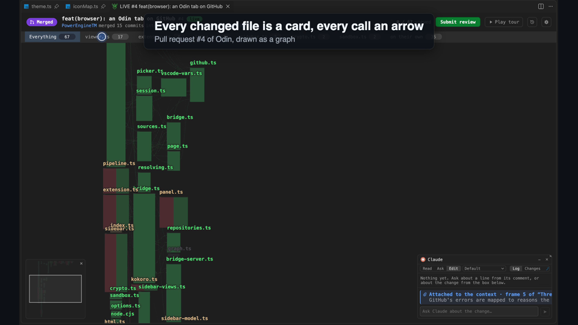
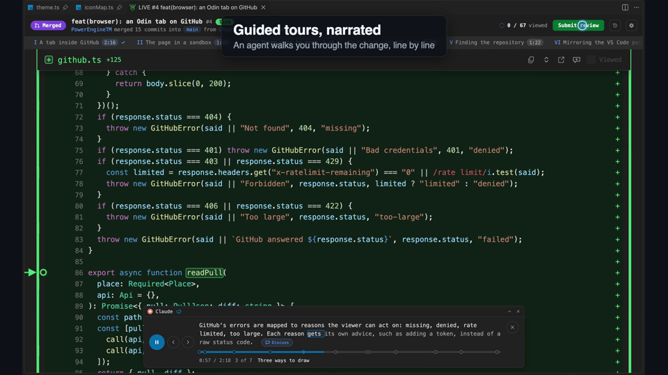
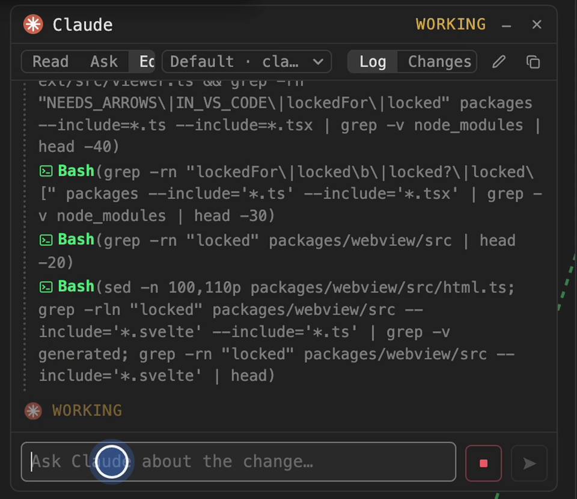
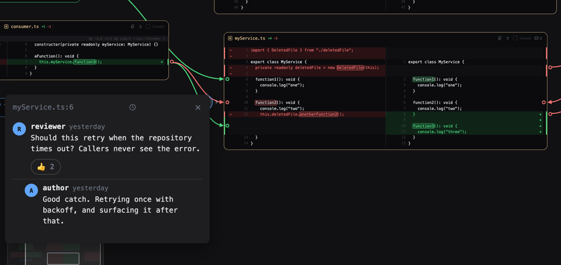
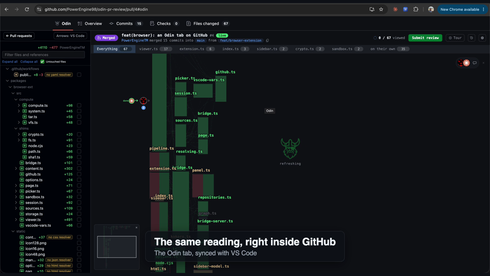
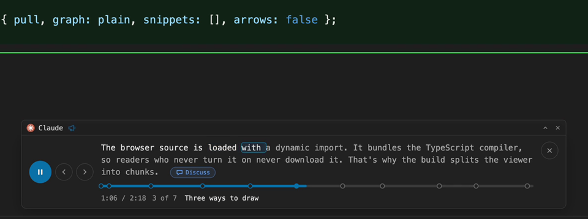
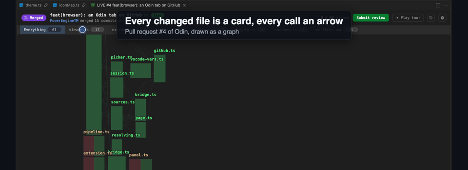
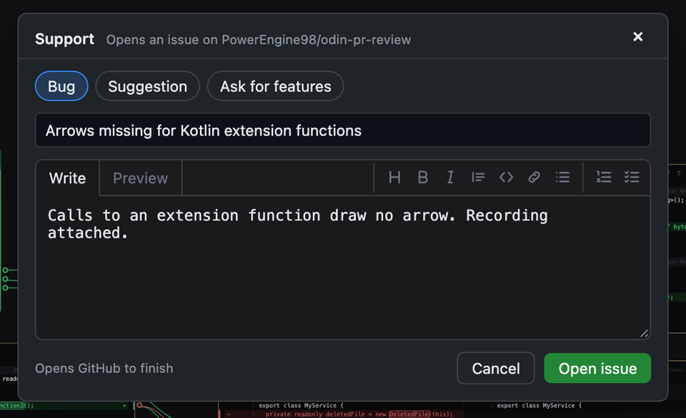

<p align="center">
  
</p>

<h1 align="center">
  Odin PR Review
  <br>
  <sub><sub><sub><em>“He saw over all worlds and every man's activity and understood everything he saw.”</em></sub></sub></sub>
  <br>
  <sub><sub><sub>Snorri Sturluson, <em>Prose Edda</em></sub></sub></sub>
</h1>

<p align="center">
  <strong>Review a pull request as a picture of the change, and let an AI walk you through it.</strong>
</p>

<p align="center">
  <a href="https://marketplace.visualstudio.com/items?itemName=powerengine98.odin-pr-review"></a>
  <a href="https://open-vsx.org/extension/powerengine98/odin-pr-review"></a>
  <a href="https://chromewebstore.google.com/detail/odin-pr-review/jghenlmadcfkcmfmnlmegogfjbbeafci"></a>
</p>

<p align="center">
  <a href="https://open-vsx.org/extension/powerengine98/odin-pr-review"></a>
  <a href="https://github.com/PowerEngine98/odin-pr-review/actions/workflows/publish.yml"></a>
  <a href="LICENSE"></a>
</p>

<p align="center">
  <a href="#get-odin">Get Odin</a> ·
  <a href="#quick-start">Quick start</a> ·
  <a href="#features">Features</a> ·
  <a href="#renderers">Renderers</a> ·
  <a href="docs/architecture.md">How it works</a>
</p>

<p align="center">
  <a href="docs/demo.mp4"></a>
  <br>
  <sub>A minute of Odin on its own pull request. <a href="docs/demo.mp4">Watch with sound</a>.</sub>
</p>

---

A pull request is a graph, not a list of files. **Odin draws it that way.** Every
changed file is a card with its diff, and every call the change adds or removes
is an arrow from the exact line that calls to the exact line that is called.
Then an agent reads the whole change and **gives you a tour**, narrated, in the
order the code runs.

Writing code has had an IDE for forty years; reading it has had a web page.
Odin is an **Integrated Review Environment**: the change, the conversation about
it and your progress through it, in one place, in your editor or right on GitHub.

## Features

- **🗺️ The change as a graph.** Files are cards, references are arrows: green where the change adds a call, red where it takes one away. Click an arrow to follow it. Coloured by your own theme, with a minimap, folders and filters.

  <p align="center"></p>

- **🎧 Guided tours.** An agent reads the change and writes a tour: topics in the order the code runs, frames that fly to the code, highlight lines, draw arrows and sketch diagrams, with the decisions explained the way a senior engineer would. Play it like a video, with subtitles, chapters and a timeline. Argue with any frame by sending it to the agent.

  <p align="center"></p>

- **🤝 AI pairing.** Ask        about a line, a thread or the whole change. Choose how much each one may do and on which model, approve what it asks for, and see every file it touched. Conversations carry on from one question to the next.

  <p align="center"></p>

- **💬 The whole review, in place.** Threads sit next to the lines they were left on. Reply, react, suggest changes, mark files viewed, see checks, and submit your review, without leaving the graph. Comments take pictures and videos too.

  <p align="center"></p>

- **🌐 Odin on GitHub.** The browser extension adds a **Graph** tab to every pull request and a **Change graph** tab to the repository. Synced with VS Code, it is the same reading as the editor: arrows, tours, AI pairing, narration and reviews, with no token to set up.

  <p align="center"></p>

- **🔊 Narration.** Tours and answers read aloud, with each word boxed as it is spoken, by your browser, your system's voice, or a neural voice that runs on your machine (Kokoro).

  <p align="center"></p>

- **⚡ Live readings.** Review your own uncommitted work as you write it. The graph follows the working tree, branch switches, merges and rebases.

  <p align="center"></p>

- **🛟 Support from the graph.** Report a bug or ask for a feature from Settings; it becomes an issue here, posted through your own GitHub account, recordings included.

  <p align="center"></p>

## Get Odin

| Where | For | Install |
| --- | --- | --- |
| **VS Code Marketplace** | VS Code | [Install](https://marketplace.visualstudio.com/items?itemName=powerengine98.odin-pr-review) or `code --install-extension powerengine98.odin-pr-review` |
| **Open VSX** | Cursor, Windsurf, VSCodium, Gitpod | [Install](https://open-vsx.org/extension/powerengine98/odin-pr-review) from the editor's extensions view |
| **Chrome Web Store** | Chrome, Edge, Brave, Opera | [Add to browser](https://chromewebstore.google.com/detail/odin-pr-review/jghenlmadcfkcmfmnlmegogfjbbeafci) |
| **GitHub Releases** | Anything above, offline | [`.vsix` and browser `.zip`](https://github.com/PowerEngine98/odin-pr-review/releases) |
| **Command line** | Terminals, scripts, agents | `./scripts/install.sh` from a clone, see [the CLI](packages/cli/README.md) |

Every merge to `main` publishes to all three stores at once.

## Quick start

**In the editor**

1. Install Odin. If the [GitHub CLI](https://cli.github.com) is missing or signed out, Odin opens a
   setup wizard: why it is needed, a one-click install, and GitHub's own sign-in. Odin never sees
   your password or token; gh keeps it in your keychain.
2. Open a repository and click the Odin mark in the activity bar.
3. Pick a pull request, or read your own branch live.
4. Switch on an agent and press **Give me a tour**.

**On GitHub**

1. Add the browser extension and open any pull request's **Graph** tab.
2. For arrows, tours and AI pairing, choose **Enable all features → Sync with
   the VS Code extension** and allow it in VS Code.

**From a terminal**

```sh
odin view                 # render the branch under review and print the URL
odin graph --summary      # a readable overview of the change
```

## Renderers

One graph, drawn wherever you read:

| Renderer | What you get |
| --- | --- |
| **VS Code panel** | The full review environment: graph, tours, pairing, threads |
| **GitHub tab** | The same, inside the pull request page |
| **Interactive HTML** | `odin view`, a self-contained page you can open or share |
| **SVG** | A static picture for docs and slides |
| **Mermaid** | Paste into Markdown, GitHub renders it |
| **Graphviz DOT** | For your own layouts and tooling |
| **JSON** | The change graph itself, for agents and scripts |
| **Terminal summary** | Files, references and their direction, as text |

Formats and flags: [the CLI](packages/cli/README.md).

## Languages

| Language | Arrows |
| --- | --- |
| TypeScript, JavaScript, React | Resolved by the TypeScript compiler |
| Kotlin, Python, Clojure | Matched against the repository's declarations |
| SQL, PostgreSQL | By name, with the schema as a card of its own |
| Everything else | Cards and diffs, labelled as such |

## Privacy

No telemetry and no servers of our own. Pull requests come from GitHub through
your own `gh` session, agents run as the tools installed on your machine under
your accounts, and the browser extension only talks to GitHub and, if you pair
it, to VS Code on `127.0.0.1`. [Privacy policy](PRIVACY.md).

## Learn more

- [The VS Code extension](packages/vscode-ext/README.md) and [in depth](docs/editor.md)
- [The browser extension](packages/browser-ext/README.md)
- [The command line](packages/cli/README.md)
- [How it works](docs/architecture.md): the graph, layout, packages and language support
- [Development](docs/development.md): building, testing and releasing

## Contributing

Issues and pull requests are welcome. The fastest way to report something is
**Settings → Send feedback** inside Odin, which files the issue with your
version and any recording attached. See [development](docs/development.md) to
build it locally.

<p align="center"><sub><a href="LICENSE">MIT</a> © PowerEngine98</sub></p>
