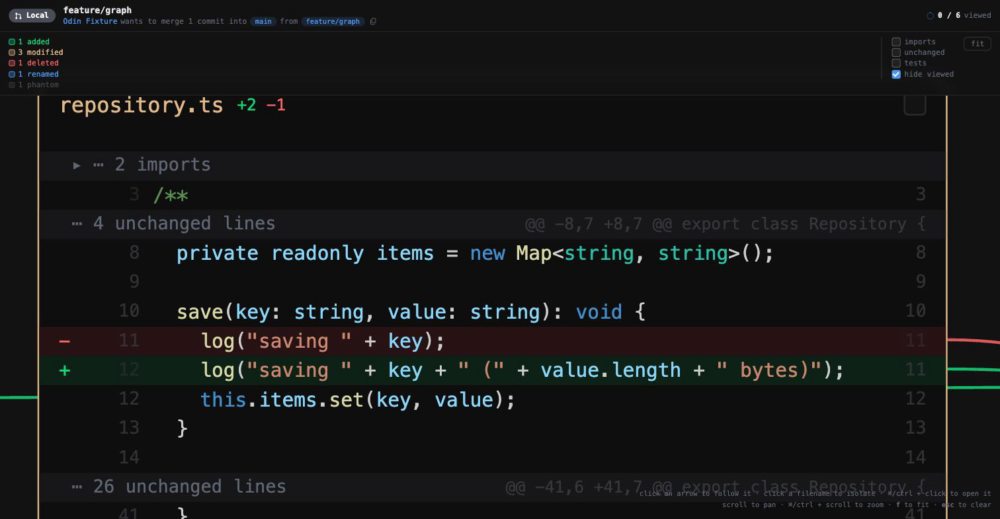

# How Odin works

Back to the [main README](../README.md).

## How it works

The diff is taken from the **merge base**, not the tip of the base branch, so
the graph shows what the branch did rather than what happened on main in the
meantime.

Added and removed lines are resolved separately, against different checkouts.
A removed line does not exist in the working tree, so resolving it there would
be guesswork; instead the merge base is extracted into a temporary directory
with `git archive` and resolved against that. Reviewing a pull request never
mutates the repository being reviewed.

Edge colour comes from the line the call site sits on: a reference written on an
added line is an added reference, one written on a deleted line is a removed
reference. Targets that were never touched by the diff join the graph as
**phantom** vertices, drawn dimmed, so you can see what a change now depends on.

Where an arrow points at code the diff does not show, the source around it is
read straight out of git. Without that an arrow could only reach the edge of a
card — naming the file, but not the function.

## Layout is deterministic on purpose

The same pull request must always produce the same picture. Node ids derive from
the file path, every collection has a canonical order, JSON keys have fixed
precedence, card geometry comes from constants rather than measured text, and
the generation timestamp is opt-in. Identical inputs produce byte-identical
output — `scripts/generate-examples.sh` rerun on an unchanged tree leaves no
diff. Anything else would move nodes between runs and destroy the spatial memory
the tool exists to build.

## Packages

| Package | Role |
| --- | --- |
| `@odin/core` | Diff parsing, graph model, layout, validation, exporters. No editor dependency. |
| `@odin/resolver-ts` | Reference resolution through the TypeScript compiler API. |
| `@odin/resolver-kotlin` | Kotlin reference resolution by symbol index. |
| `@odin/webview` | The interactive renderer, emitted as one self-contained document. |
| `@odin/highlight` | Syntax colouring, from VS Code's own grammars by way of Shiki. |
| `@odin/cli` | `odin` — render a change graph, and review through it, from the terminal. |
| `odin-pr-review` | The VS Code extension. Bundled to CommonJS, since the editor loads extensions that way. |
| `@odin/browser-ext` | The browser extension: Graph and Change graph tabs on GitHub, built from the same core and renderer. |

Reference resolution sits behind an interface, so the same graph can be produced
headlessly by the compiler API or inside the editor by a language server.

## For coding agents

`.claude/` carries skills and commands so an agent can install and drive the
tool without being told how each time.

| Skill | For |
| --- | --- |
| `odin-setup` | Building it, putting `odin` on PATH, installing the extension, and the three failures that actually happen. |
| `odin-graph` | Rendering a review and getting a url; which format answers which question. |
| `odin-review` | Reading the comments already on a pull request, and writing new ones. |

Two slash commands sit on top: `/odin` renders the current branch and hands back
a url, `/odin-review` reads a pull request and drafts feedback.

The review skill is deliberately restrictive. A review is visible to the whole
team and cannot be withdrawn from here, so it tells the agent to dry-run first,
to wait for the user to say yes, and never to approve unless approval is what
was asked for. Reading needs no such ceremony — `odin comments` and
`odin graph --summary` cost nothing and answer most questions.

## Status

Done:

- [x] Change-graph model and reproducible JSON schema
- [x] Unified-diff parser (added, modified, deleted, renamed, binary)
- [x] Reference resolution for TypeScript, JavaScript, Kotlin, Python, Clojure
      and SQL, including the parts that are only Postgres
- [x] The database schema as a vertex: tables and functions as rows, with the
      migrations that use them pointing at the row rather than at each other
- [x] jOOQ: generated constants, records, enums and routines resolved back to
      the schema objects they were generated from
- [x] Phantom vertices for referenced-but-untouched files
- [x] Deterministic layered layout with line-level arrow anchors
- [x] Interactive renderer: follow an arrow, isolate a file, pan and zoom
- [x] Split and unified diff readings, switchable per reader
- [x] SVG, Mermaid, Graphviz and terminal output
- [x] Collapsed gaps for untouched code, with base/head line-number columns
- [x] Syntax highlighting inside cards, using the editor's own theme
- [x] VS Code extension: open the real file at the line an arrow points at
- [x] Review from inside the graph: threads, replies, reactions, suggestions,
      and a pending review that goes out as one verdict
- [x] Sub-graphs: a large change split into the parts that do not reach each
      other, each with its own progress and its own camera
- [x] Keyboard review — walk the chain, mark read, comment, open the file —
      with rebindable keys
- [x] Progress that persists: viewed files, per-part camera, unsent drafts
- [x] Pull-request chooser: what is waiting on you first, and which branches
      have moved since you last read them
- [x] A minimap, forge checks, reviewers and the conversation, each dismissable
- [x] Virtualisation: a card more than a screen and a half away, or zoomed past
      legibility, is not rendered

Next:

- [ ] Layout pinning, so a file keeps its place across pushes
- [ ] Cross-package edges in monorepos that import through built declarations
- [ ] Resolvers for more languages — the index-based engine takes a new one in
      about a hundred lines
- [ ] Review a pull request without checking its branch out

## Language support

| Language | Resolver | Confidence | Both sides |
| --- | --- | --- | --- |
| TypeScript, JavaScript | TypeScript compiler API | `resolved` | yes |
| React (`.tsx`, `.jsx`) | TypeScript compiler API | `resolved` | yes |
| Kotlin | symbol index | `heuristic` | yes |
| Python | symbol index | `heuristic` | yes |
| Clojure | symbol index | `heuristic` | yes |
| SQL | name index | `heuristic` | yes |
| PostgreSQL | name index | `heuristic` | yes |
| anything else | — | — | — |

A file in an unsupported language still becomes a card with its diff — it just
has no arrows. That is reported rather than left to inference: the card is
outlined with a dashed border and labelled `no <language> resolver`, the
toolbar names the gap, and `meta.coverage` records it in the JSON. A card with
no arrows would otherwise be indistinguishable from a file that genuinely
references nothing, and a reviewer who cannot tell those apart will read a
blind spot as a clean bill of health.

Colouring is a separate question from resolution, and a wider one. The code in
a card is highlighted by VS Code's own TextMate grammars, through
[Shiki](https://shiki.style), so a Kotlin file reads the same here as in the
editor beside it; nothing is written by hand and nothing runs in the browser,
since the colouring happens where the page is built. Inside the editor it uses
**your** theme, not an approximation of it: the extension finds whichever one
`workbench.colorTheme` names, reads it the way the editor does — following the
`include` chain, since a theme is usually a thin file over a thick one — and
hands it to Shiki. A theme it cannot find or parse falls back to VS Code's
default rather than to no colour. On the command line there is no editor to ask,
so the default is what you get. Thirty grammars ship with
the tool — the ones teams actually review — rather than the two hundred Shiki
carries, and a language outside that list is said out loud in the toolbar
(`no highlighting for dart`) instead of appearing as a card that is quietly
grey. Adding one is a line in `packages/highlight`.

A component written into a page is a call: `<Header />` runs `Header`, and gets
the same arrow a function call does — on a React codebase that is most of them,
and a page rendering six components would otherwise show none. `<Icons.Chevron />`
resolves the same way a property call does. Plain HTML is skipped: `
`
resolves into React's own intrinsic-element declarations, which is not somewhere
a reviewer can usefully be sent, and the capital letter that tells them apart is
the convention the compiler itself uses.

Kotlin, Python and Clojure edges are marked `heuristic` because they come from
matching call sites against an index of the repository's declarations rather
than from a compiler. None of the three can be asked where a name goes without
running something that knows the project — a compiler daemon, a language server,
a REPL with the code loaded — and a review tool that needed any of those would
give different answers on the command line and in the editor.

The ordering is the language's own: what the call qualifies, then what the file
imported by name, then what it imported whole, then its own module, then a match
that is unique in the repository. Past that, ambiguity is declined rather than
guessed — where two declarations share a name and nothing in the file separates
them, no arrow is drawn. A missing arrow is recoverable; one that sends you to
the wrong file is not.

SQL is the odd one and the most reliable of them. A schema has no modules and no
imports, so there is nothing to disambiguate with — but there is also almost
nothing to disambiguate: two tables cannot share a name inside a schema, so a
`REFERENCES customers` points at the migration that wrote `CREATE TABLE
customers` and at nothing else. Migrations become a graph of what depends on
what, which is the question asked of them most often.

Postgres gets its own dialect on top, because the references a reviewer follows
there are not portable SQL: a trigger naming the function it runs, a column
reading a sequence through `nextval`, a partition naming its parent, a cast to a
type somebody declared. Which one a file gets is decided by the file: nearly
every Postgres project names its migrations `.sql`, so the extension cannot say,
and the text is asked instead — nobody writes `$$ … $$ LANGUAGE plpgsql` by
accident.

### The schema as a vertex, and the code that talks to it

A migration set read as a graph of files answers the wrong question. Nobody asks
which migration mentions which other migration; they ask what this change does
to the `invoices` table, and what else touches it. The table is the thing, and
in a diff it is only ever implied — a name on a line in one file and a name on a
line in another.

So the objects are lifted out and given a card of their own: one per schema, a
row per table, view, function, sequence or type that the change touches. Every
reference lands on the row it names rather than on the file that happens to
declare it, and each object points at whatever created it — so the migration
that made a table is one arrow away, in the direction the question is asked.

Code reaches the same objects through generated classes, and that link is the one
a reviewer cannot see: a migration renames a type and the projection that reads
it is in another language, in another directory, under a name that does not
match. jOOQ generates mechanically — a table becomes a constant in upper snake
and a class in pascal, its rows become `…Record`, an enum keeps its name, a
function becomes a routine — so the name in the code is the name in the database
with the case changed, and the arrow can be read rather than guessed.
`NotificationRecord` lands on `table notification`, `LaborNotificationType` on
`type labor_notification_type`, `NOTIFICATION.asterisk()` on the table it names.
Only in files that import jOOQ: a `NotificationRecord` that has nothing to do
with the database is an ordinary class name, and linking it because the
repository uses jOOQ elsewhere would be a confident lie.

Schema links do not split the change into parts. Nearly everything in a backend
touches the database, so letting them group it would fuse the whole review into
one part and take away the split that makes a large one readable; the schema
travels into every part instead.

Python and Clojure share one engine, since a module and a namespace are the same
idea spelled the same way. What differs is per language: Python's relative
imports climb from the importing file's package, its decorators are references
worth following, and a package is its directory rather than its `__init__`;
Clojure's `ns` form is read over the whole file because it wraps, a namespace
maps to a path with its dashes turned into underscores, and the special forms
every function body opens with are kept out so `let` does not draw arrows.

### Known gaps

- In a monorepo where packages import each other through built type
  declarations, cross-package edges are dropped: the definition resolves into a
  `.d.ts`, which the domain filter treats as third-party. Following declaration
  maps back to source would recover them.
- A file with hundreds of added lines becomes a very tall card, since there is
  nothing unchanged in it to collapse.
- Large pull requests still build every card's markup up front, even though only
  what is near the screen is rendered. Past a few thousand files the document
  itself becomes the cost.
- A review still needs the branch checked out locally; there is no read-only
  mode that works straight from the forge.
