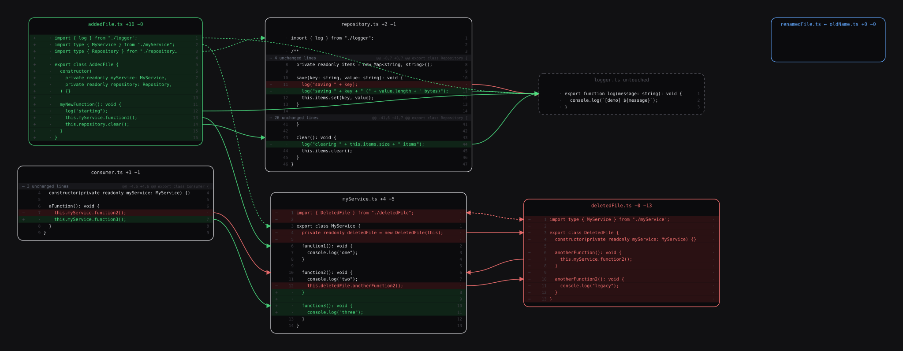
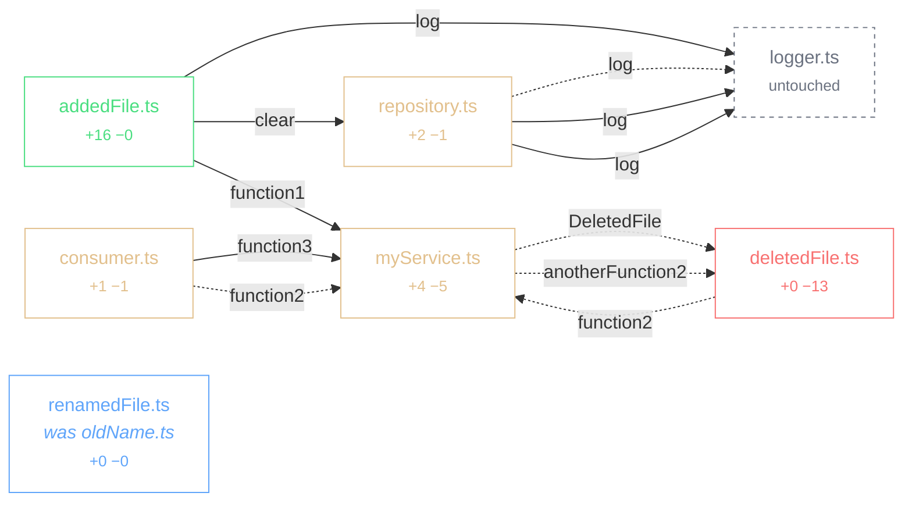

# Odin's command line

The `odin` command builds the same change graph as the editor and writes it in any of
the formats below. Back to the [main README](../../README.md).

## Install

macOS and Linux, from a clone:

```sh
./scripts/install.sh
```

It checks what is on the machine, installs the dependencies, builds every
package, packages the extension and installs it into VS Code — then links the
command line tool into `~/.local/bin` if that is somewhere it can write.

One line of noise is expected on the way past: `The engine "vscode" appears to
be invalid`. VS Code requires `engines.vscode` in the extension's manifest and
yarn 1 does not recognise it, so it says so every time and nothing is wrong.

Afterwards, Odin updates itself:

```sh
odin update
```

Which copy it works on is the interesting part, and it is decided by where you
are standing:

- **inside a clone** — that clone, wherever in the tree you are
- **anywhere else** — the copy the command was installed from, found by
  following `odin` on your PATH back through its symlink
- **neither** — one is fetched into `~/.local/share/odin/checkout`, for a
  machine that was handed a `.vsix` rather than a clone

Then local work wins. A checkout with changes of its own — uncommitted, or
committed and not yet on `main` — is built and installed as it stands, because
that is what standing in it means: the usual reason to reinstall is to try the
change you just made. Only a clean checkout that is purely behind is pulled,
and by fast-forward, so an update is never the thing that starts a merge or
resolves a conflict on your behalf. A copy that has diverged is installed as it
is, and one on another branch is left alone.

Nothing to do means nothing is built. `--dry-run` says which of those it would
be, `-C <dir>` looks somewhere else, and `--branch <name>` follows something
other than `main`.

Two things it will not do for you. `gh` is what Odin asks for pull request
titles, comments, checks and the list of what is open, so install it and run
`gh auth login` if the script says it is missing — everything else works
without it, against whatever branch is checked out. And if you have no `code`
on the PATH the extension is built but not installed; the script says where the
package is, and VS Code adds the command itself from **Shell Command: Install
'code' command in PATH**. It looks inside the usual application bundles first,
so on macOS this rarely comes up.

Then open a repository in VS Code and run **Odin: Review** from the palette, or
press the Odin mark in the activity bar to pick a pull request.

## Quick start

```sh
yarn install
yarn build
ln -sf "$PWD/packages/cli/dist/main.js" ~/.local/bin/odin   # or call it by path

# Render the change under review and print the url to open
odin view

# Human-readable overview
odin graph --summary

# The graph itself
odin graph --resolve -o graph.json
```

`view` is the one command worth remembering. It renders what the editor shows —
references resolved, the pull request's own comments marked against their lines
— writes it beside the repository and prints a `file://` url. The file name
comes from the repository and the branch pair, so reopening the same review
reopens the same address; `--serve [port]` hands back an `http://127.0.0.1` one
instead, for the callers a file url cannot reach.

The page it writes cannot post anything back — there is nothing behind a file to
post through. Writing is the command line's own job:

```sh
odin comments                                  # what has already been said
odin review --event comment --body "notes" \
  --comment "src/Dao.kt:180-185:this reads twice" --dry-run
odin approve
```

Everything that touches the forge goes through `gh`, so it acts as whoever is
authenticated and this program stores no credentials of its own. `--dry-run`
prints the exact payload and sends nothing, which is where a malformed comment
gets caught — the forge rejects a whole review for one bad range, taking every
other remark in it down as well.

Try it against the built-in fixture, which reproduces the design sketch:

```sh
fixtures/make-demo-repo-ts.sh /tmp/odin-demo
node packages/cli/dist/main.js graph -C /tmp/odin-demo -b main -H feature/graph \
  --resolve --format html -o /tmp/odin-demo.html
```

## Renderers

One layout engine feeds every output, so they are the same picture in different
materials rather than four independent drawings.

### Interactive — `--format html`

A single self-contained file. No server, no network, no build step: open it from
disk, or hand the same markup to an editor webview.

Hovering an arrow isolates it and names the reference it resolved to. Clicking
an arrow travels to its destination and flashes the card, which is the gesture
the whole tool is built around — you follow a change the way you would follow it
in an editor, but without losing your place.


Everything the page can be told to do is behind one button. The gear holds the
diff display (split or unified), what to show (imports, unchanged references,
tests, whether to hide files whose relations have all been read), which corners
of the screen to keep (reviewers, comments, the map), a key-binding panel, and
the note about any language it could not colour.


A change that comes apart into pieces is shown as pieces: the tabs along the top
are the parts of the graph that do not reach each other, each with its own file
count, its own progress and its own camera. Coming back to a part puts you where
you left it.

Cards show the change, not the file. A run of untouched code that no arrow
reaches collapses into a single band carrying the hunk header, so a card stays
the size of its change rather than the size of its file. Line numbers run in two
columns — base on the left beside the +/− marker, head on the right — because a
single shared column interleaves the two numbering schemes and reads as nonsense
on any file that both gained and lost lines. A line that exists on one side only
leaves the other column empty, the way the forge leaves it: a stand-in number
there is either the same value repeated down a whole insertion, or a number the
line does not have. A wholly added or deleted file is the exception — it has one
numbering, and both columns carry it, because an empty column down a whole card
reads as a column that failed to draw.

| Gesture | Effect |
| --- | --- |
| Hover an arrow | Isolate it, show the resolved reference and its confidence |
| Click an arrow | Travel to the definition it points at |
| Click the dot at an arrow's start | Put its destination in the middle of the screen |
| Click a boxed name at either end | Travel to the other end |
| Click the dot inside the card an arrow lands in | Go back to where that arrow came from |
| Click a filename | Isolate that file and everything it touches |
| Scroll / ⌘-scroll | Pan / zoom around the cursor |
| Click a gap | Open the untouched code it stands for |
| Click *show N more lines* | Reveal the rest of a truncated card |
| `h` / `esc` | Fit the graph / clear the selection |
| `←` `→` `↑` `↓` | Walk to the next file in the chain |
| `enter` / `c` / `F` | Mark it read / comment on it / open it in the editor |

Import statements are folded into a band and their arrows hidden, both governed
by the **imports** checkbox. An import the change added or removed is never
folded away — it is a change, and folding it would hide the thing the card
exists to show — so it stays on screen with the untouched imports folding either
side of it. Nothing a diff touched is ever collapsed. A Kotlin file can open with thirty imports, which
pushes the actual change off the bottom of the card. They are still resolved, so
switching them on needs no rebuild — `--imports` does the same on the command
line.

Files the change touched always stay on the canvas. **hide viewed relations** takes
away the untouched files once everything pointing at them has been read, since
those are in the picture only because something referenced them; a file the
change touched goes quiet when you tick it — dimmed, struck through in the
sidebar — but it does not leave. A picture of a change with its read files
removed is a picture of something else.

Clicking a file in the sidebar brings its card to the middle of the canvas.
Opening the file itself is the card's own **Jump to file** button, beside the
reviewed box: choosing a file to look at and opening an editor on it are
different intentions, and doing both on one click means one of them was never
asked for. The button is absent where the page has no editor to ask — a graph
opened from disk cannot open anything.

Test files are hidden by default, and the **tests** checkbox brings them back.
A test tends to reference a great deal of what it exercises: on a 24-file
change here, one test file accounted for 23 of the 35 edges and buried
everything else. They are hidden rather than dropped, because sometimes the
tests *are* the change. `--tests` does the same on the command line.

A line an arrow points at is always shown. It survives the untouched-code
collapse, it survives the import fold, and the source around it is fetched when
the diff itself does not reach that far — material that overlaps the hunk above
it is trimmed to the part that is new rather than dropped whole, which used to
take the pointed-at line with it. On a 164-edge Kotlin branch every target now
lands on its own line.

A card shows every line the change touched, however many there are, and every
line something points at. The 42-row cap holds back only what is neither: a tail
of untouched context hanging off the end, behind a bar that reveals it. A card
is a picture of a change, and holding part of that change behind a bar the
reader has to notice is how a review misses something.

An import names a file rather than a position in it, so those arrows meet the
card at its title instead of landing on whatever line one happens to hold.

Both ends of an arrow carry a box around the name, in the change's own colour:
the call at the near end, the definition it resolved to at the far one. The
arrow reaches a line; the box says which word on it, which is the difference
between "somewhere in here" and the answer. Pressing either box travels to the
other end, and a dot where the arrow leaves does the same for the destination.
Following a reference across a large change otherwise means finding the other
end by eye and then finding your way home the same way.

Source: [`docs/examples/graph.html`](../../docs/examples/graph.html).

### Static — `--format svg`

The same layout, frozen. Useful for attaching to a pull request, and as a
regression test: if the layout shifts, the file changes.



### Mermaid — `--format mermaid`

Structure only, for a pull request description or anywhere Mermaid renders.
It cannot show diff lines or anchor an arrow to one, so it answers "what talks
to what" rather than "what changed where".



Source: [`docs/examples/graph.mmd`](../../docs/examples/graph.mmd) (the block above
drops import edges for legibility).

### Graphviz — `--format dot`

For pipelines that already consume DOT.
Source: [`docs/examples/graph.dot`](../../docs/examples/graph.dot).

### Terminal — `--summary`

```
main...feature/graph
merge-base bbb36260ba95

A  src/addedFile.ts    +16 -0
M  src/consumer.ts    +1 -1
D  src/deletedFile.ts    +0 -13
~  src/logger.ts    +0 -0
M  src/myService.ts    +4 -5
R  src/renamedFile.ts  (was src/oldName.ts)    +0 -0
M  src/repository.ts    +2 -1

7 nodes, 16 edges

- src/myService.ts:12 -> src/deletedFile.ts:10 anotherFunction2 [resolved]
+ src/addedFile.ts:13 -> src/myService.ts:2 function1 [resolved]
+ src/addedFile.ts:14 -> src/repository.ts:43 clear [resolved]
+ src/consumer.ts:7 -> src/myService.ts:10 function3 [resolved]
- src/consumer.ts:7 -> src/myService.ts:10 function2 [resolved]
- src/deletedFile.ts:7 -> src/myService.ts:10 function2 [resolved]
```

Note the two `src/consumer.ts:7` lines. One call site, edited in place, resolving
to different definitions on either side of the change — and to different lines,
because `myService.ts` was edited too.
